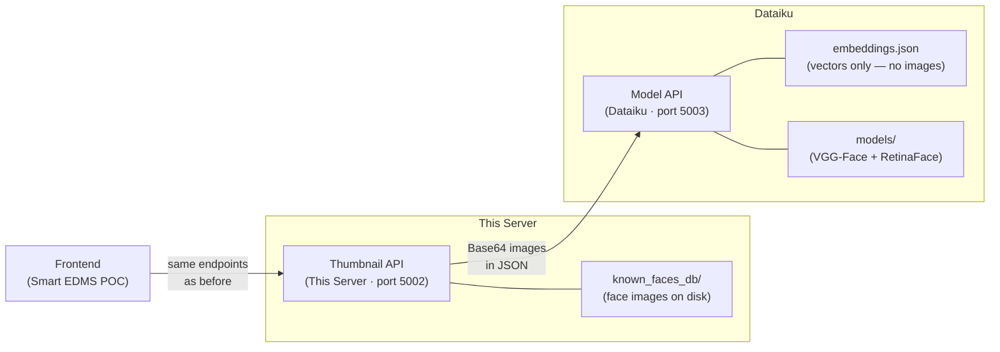
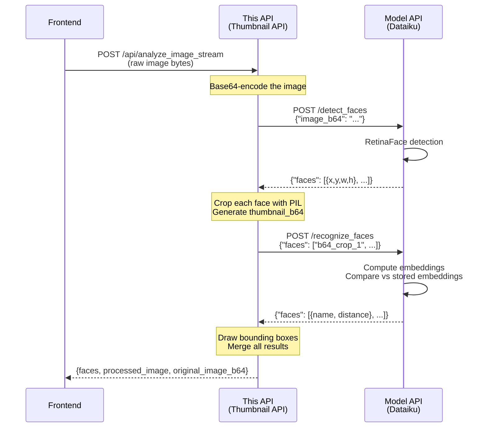
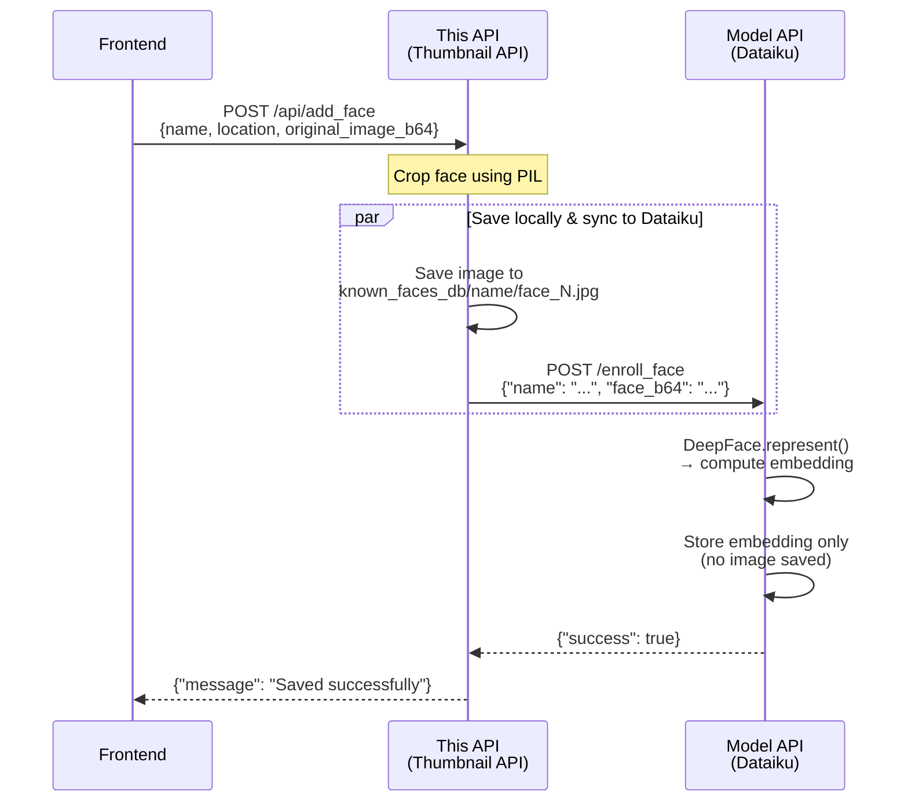

# Thumbnail API (Face Recognition Gateway) — Architecture

This API is the **frontend gateway** for face analysis. It handles all image
manipulation (cropping, thumbnails, bounding boxes) and stores face images
locally. All ML inference is delegated to the Dataiku Model API via HTTP.

---

## System Overview



---

## What This API Does

| Responsibility | Details |
|---------------|---------|
| **Serve Frontend** | Exposes the same endpoints the frontend has always used |
| **Image Cropping** | Crops detected faces from images using PIL |
| **Thumbnail Generation** | Creates Base64-encoded face thumbnails |
| **Bounding Box Drawing** | Annotates images with green boxes and name labels |
| **Face Image Storage** | Saves enrolled face images in `known_faces_db/` |
| **Proxy to Dataiku** | Forwards images to Dataiku for detection/recognition |

## What This API Does NOT Do

| Responsibility | Handled By |
|---------------|-----------|
| Load ML models | Dataiku Model API |
| Detect faces | Dataiku Model API |
| Recognize faces | Dataiku Model API |
| Store embeddings | Dataiku Model API |

---

## Endpoints (Unchanged for Frontend)

The frontend communicates with this API exactly as before — **zero changes required** in the frontend code.

### `POST /api/analyze_image`
Multipart form upload. Accepts `image_file` field.

**Internal flow:**
1. Read image bytes from multipart form
2. Base64-encode → forward to Dataiku `/detect_faces`
3. Crop faces locally → generate `thumbnail_b64`
4. Forward crops to Dataiku `/recognize_faces`
5. Draw bounding boxes → generate `processed_image`
6. Return merged JSON response

### `POST /api/analyze_image_stream`
Raw byte stream upload.

Same internal flow as above, but reads raw bytes from the request body.

### `POST /api/add_face`
Enroll a new face. Accepts JSON:
```json
{
    "name": "Ahmed Bahrozyan",
    "location": [top, right, bottom, left],
    "original_image_b64": "<base64 string>"
}
```

**Internal flow:**
1. Crop face from the original image using the location coordinates
2. Save cropped image to `known_faces_db/<name>/face_N.jpg` (locally)
3. Base64-encode the crop → forward to Dataiku `/enroll_face`
4. Dataiku computes the embedding and stores it (no image saved on Dataiku)

### `POST /api/recognize_faces`
Recognize pre-cropped faces. Accepts JSON:
```json
{ "faces": ["<b64_crop_1>", "<b64_crop_2>"] }
```

Forwards directly to Dataiku `/recognize_faces` and returns the result.

---

## Data Flow: Analyze Image (Full Pipeline)



## Data Flow: Enroll a Face



---

## How the Split Works

### Before (Monolithic)

```
One API does everything:
┌─────────────────────────────────────────┐
│  app.py + face_processor.py             │
│  ├── ML Models (VGG-Face, RetinaFace)   │
│  ├── Face Detection                     │
│  ├── Face Recognition                   │
│  ├── Thumbnail Generation               │
│  ├── Bounding Box Drawing               │
│  └── known_faces_db/ (images)           │
└─────────────────────────────────────────┘
```

### After (Split)

```
Thumbnail API (this server)          Dataiku Model API (Dataiku)
┌──────────────────────────┐         ┌──────────────────────────┐
│  app.py                  │  HTTP   │  dataiku_model_api.py    │
│  ├── Thumbnail Generation│ ──────► │  ├── ML Models           │
│  ├── Bounding Box Drawing│         │  ├── Face Detection      │
│  ├── Image Cropping      │ ◄────── │  ├── Face Recognition    │
│  └── known_faces_db/     │  JSON   │  └── embeddings.json     │
│      (images on disk)    │         │      (vectors only)      │
└──────────────────────────┘         └──────────────────────────┘
```

**Key benefit:** This API no longer needs TensorFlow, DeepFace, or any ML
dependencies. It's now a lightweight Flask + PIL server.

---

## File Structure

```
Face Recognition py/
├── app.py                  # Flask API — proxies to Dataiku, handles images
├── migrate_embeddings.py   # One-time script to seed Dataiku with existing faces
├── known_faces_db/         # Face images (organized by person name)
│   ├── ahmed_bahrozyan/
│   │   ├── face_1.jpg
│   │   └── face_2.jpg
│   ├── mattar_al_tayer/
│   │   └── face_1.jpg
│   └── ...
├── requirements.txt        # Lightweight: Flask + PIL + requests only
├── web.config              # IIS configuration
├── ARCHITECTURE.md         # This file
└── face_processor.py       # DEPRECATED — kept as reference only
```

---

## Environment Variables

| Variable | Default | Description |
|----------|---------|-------------|
| `HTTP_PLATFORM_PORT` | `5002` | Port to serve on |
| `DATAIKU_MODEL_API_URL` | `http://localhost:5003` | URL of the Dataiku Model API |
| `KNOWN_FACES_PATH` | `./known_faces_db` | Directory for face image storage |
| `DATAIKU_TIMEOUT_SECONDS` | `300` | Timeout for Dataiku API calls (seconds) |

---

## Setup & Migration

### 1. Install Dependencies (slimmed down — no ML packages)

```bash
pip install -r requirements.txt
```

### 2. Configure Dataiku URL

```bash
set DATAIKU_MODEL_API_URL=http://your-dataiku-host:5003
```

### 3. Run One-Time Embedding Migration

This seeds the Dataiku Model API with embeddings for all existing faces in
`known_faces_db/`:

```bash
python migrate_embeddings.py
```

### 4. Start the API

```bash
python app.py
```

---

## Resilience

If the Dataiku Model API is temporarily unreachable:

- **`/api/add_face`** will still save the face image locally. The embedding can
  be synced later by re-running `migrate_embeddings.py`.
- **`/api/analyze_image*`** and **`/api/recognize_faces`** will return an error
  since they require Dataiku for detection/recognition.
