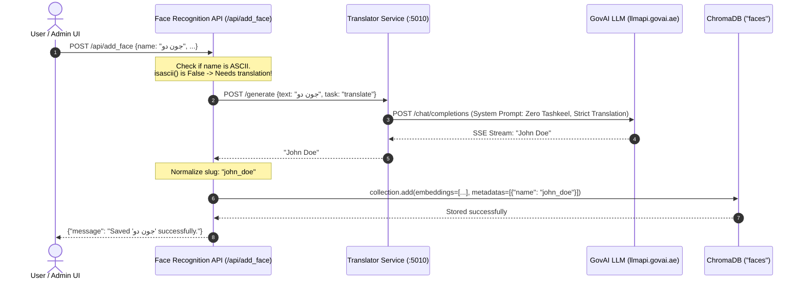
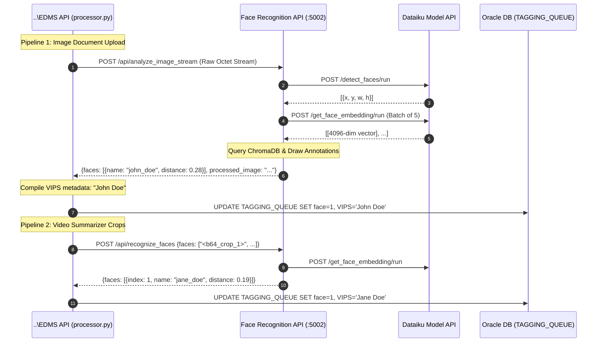

# 📸 Face Recognition API (Gateway & Thumbnail Service)

> **High-Performance Face Intelligence & Vector Recognition Gateway for the RTA Smart EDMS Ecosystem**  
> Powered by **FastAPI (ASGI)**, **ChromaDB Vector Store**, **Dataiku Model API (Remote ML Inference)**, **GovAI LLM (Bilingual Identity Normalization)**, and **Pillow (PIL)**.

---

## 📑 Table of Contents

1. [Executive Summary & Architectural Evolution](#1-executive-summary--architectural-evolution)
2. [System Architecture & Core Responsibilities](#2-system-architecture--core-responsibilities)
3. [GovAI LLM Integration](#3-govai-llm-integration)
4. [Integration with `..\EDMS API`](#4-integration-with-edms-api)
5. [Dataiku Model API Integration & Resilience](#5-dataiku-model-api-integration--resilience)
6. [Vector Database & ChromaDB Schema](#6-vector-database--chromadb-schema)
7. [API Endpoints Reference](#7-api-endpoints-reference)
8. [Codebase Structure & Module Directory](#8-codebase-structure--module-directory)
9. [Configuration & Environment Variables](#9-configuration--environment-variables)
10. [Offline Setup, Packaging & Production Deployment](#10-offline-setup-packaging--production-deployment)
11. [Testing, Diagnostics & Graphify Knowledge Graph](#11-testing-diagnostics--graphify-knowledge-graph)

---

## 1. Executive Summary & Architectural Evolution

The **Face Recognition API** serves as the face intelligence gateway for the **RTA Smart EDMS** (Electronic Document Management System) ecosystem. It identifies known VIPs and personnel in photographs and video frames, draws visual annotations, extracts face thumbnails, and indexes facial identities into an embedded vector database.

### The Architectural Shift: Monolithic vs. Decoupled Gateway

```
┌────────────────────────────────────────────────────────────────────────────────────────┐
│ DEPRECATED MONOLITHIC ARCHITECTURE (v1.0 - Flask)                                      │
│ • Local TensorFlow, Keras, DeepFace, and RetinaFace loaded directly in memory          │
│ • Gigabytes of local weights (vgg_face_weights.h5, retinaface.h5)                      │
│ • High RAM/CPU consumption, slow IIS worker startup, prone to process timeouts         │
└────────────────────────────────────────────────────────────────────────────────────────┘
                                            ▼
┌────────────────────────────────────────────────────────────────────────────────────────┐
│ CURRENT DECOUPLED GATEWAY ARCHITECTURE (v2.0 - FastAPI)                                │
│ • Lightweight FastAPI ASGI gateway running on port 5002                                │
│ • Zero local ML/TensorFlow dependencies (runs in lean, fast-booting virtualenv)        │
│ • Remote ML Inference: Delegated to Dataiku Model API (RetinaFace + VGG-Face)          │
│ • Local Vector Database: ChromaDB persistent L2 vector collection                      │
│ • Bilingual Identity Normalization: Powered by GovAI LLM (via Translator Service)      │
│ • Image Processing: Local PIL for sub-millisecond cropping, drawing & thumbnails       │
└────────────────────────────────────────────────────────────────────────────────────────┘
```

By decoupling image pre-processing from deep learning inference, the gateway achieves sub-second latency for image manipulation and vector indexing while offloading computationally intensive neural net forward passes to high-performance enterprise infrastructure.

---

## 2. System Architecture & Core Responsibilities

```
                                  ┌──────────────────────────────────────────────┐
                                  │             Smart EDMS Ecosystem             │
                                  │              (..\EDMS API)                   │
                                  │      Portal UI / Video Summarizer / Queue    │
                                  └───────┬──────────────────────────────▲───────┘
                                          │                              │
                          Streaming Image │ POST /api/analyze_image_stream│ Analyzed Faces,
                          Base64 Crops    │ POST /api/recognize_faces    │ VIP Names,
                          Enrollment      │ POST /api/add_face           │ Processed Image
                                          ▼                              │
┌────────────────────────────────────────────────────────────────────────┴─────────────────────────────────────────┐
│ Face Recognition API Gateway (FastAPI · Port 5002)                                                               │
│                                                                                                                  │
│  ┌─────────────────────────────┐        ┌──────────────────────────────┐        ┌─────────────────────────────┐  │
│  │     Routers & Ingestion     │        │    Pillow Image Engine       │        │     ChromaDB Vector Store   │  │
│  │   • /api/analyze_image      │ ─────► │   • Face Cropping (PIL)      │ ◄────► │   • Collection: "faces"     │  │
│  │   • /api/analyze_image_stream│       │   • Green Bounding Boxes     │        │   • Space: L2 Distance      │  │
│  │   • /api/add_face           │        │   • VIP Label Annotation     │        │   • 4096-dim VGG Vectors    │  │
│  │   • /api/recognize_faces    │        │   • Base64 Thumbnails        │        │   • Persistent on Disk      │  │
│  │   • /api/delete_face        │        └──────────────────────────────┘        └─────────────────────────────┘  │
│  │   • /api/list_faces         │                       ▲                                                         │
│  └─────────────────────────────┘                       │                                                         │
└───────────────────┬────────────────────────────────────┼─────────────────────────────────────────────────────────┘
                    │                                    │
                    │ 1. Non-ASCII Face Name             │ 2. Batch Face Crops
                    │    Translation Request             │    & Detection
                    ▼                                    ▼
       ┌───────────────────────────┐        ┌─────────────────────────────────────────────────────────┐
       │   Translator/Rephraser    │        │                   Dataiku Model API                     │
       │     (Port 5010)           │        │         rtauevaidss1.rtatestdom.local:13000             │
       └────────────┬──────────────┘        └────────────────────────────┬────────────────────────────┘
                    │                                                    │
                    │ OpenAI Chat Protocol                               │ RetinaFace & VGG-Face
                    ▼                                                    ▼
       ┌───────────────────────────┐        ┌─────────────────────────────────────────────────────────┐
       │      GovAI LLM Cloud      │        │       Enterprise ML Inference Engine                    │
       │   https://llmapi.govai.ae │        │    • /detect_faces/run                                  │
       │ (Arabic ➔ English Translit)│        │    • /get_face_embedding/run (Batched in 5s)           │
       └───────────────────────────┘        └─────────────────────────────────────────────────────────┘
```

### Division of Responsibilities

| Component | Handled By | Description |
|:---|:---|:---|
| **API Gateway & Routing** | FastAPI (`app.py`, `app/main.py`) | High-speed async ASGI server, CORS handling, IIS HttpPlatformHandler shim. |
| **Face Detection** | Dataiku Model API | Computes bounding box coordinates `[x, y, w, h]` via RetinaFace. |
| **Face Embedding** | Dataiku Model API | Extracts 4096-dimensional facial feature vectors via VGG-Face. |
| **Vector Storage & Search** | Local ChromaDB (`app/database.py`) | Nearest-neighbor vector indexing and L2 distance matching. |
| **Image Manipulation** | Python Pillow (`app/services/image.py`) | Sub-millisecond cropping, drawing green rectangles, typography rendering, base64 encoding. |
| **Name Normalization** | GovAI LLM (`app/services/translator.py`) | Translates Arabic names to standardized English identities before database persistence. |
| **Local Image Archive** | Filesystem (`known_faces_db/`) | Physical storage of original enrolled face images per identity. |

---

## 3. GovAI LLM Integration

### Why GovAI LLM is Required
In bilingual government environments, users and administrative systems frequently enroll personnel while operating in Arabic mode (e.g., submitting `"جون دو"` instead of `"John Doe"`). Storing mixed Arabic and English identity keys creates:
1. **Database Fragmentation**: The same individual would exist under two separate identities in ChromaDB.
2. **Metadata Inconsistencies**: Disconnected search filters across the Smart EDMS platform.
3. **Display Clutter**: Inconsistent label rendering on visual document thumbnails.

### The GovAI Translation Flow

The application integrates with the **GovAI LLM Platform** (`https://llmapi.govai.ae/chat/completions`) through the sibling **Translator / Rephraser microservice** (`TRANSLATOR_REPHRASER_API_URL`, default `http://localhost:5010`):



### Implementation Details in Code

In [app/routers/faces.py](file:///d:/projects/new%20EDMS%20py/Face%20Recognition%20py/app/routers/faces.py):
```python
name_to_store = body.name.strip()
if not name_to_store.isascii():
    logger.info("Name '%s' appears to be Arabic; translating to English before storing.", name_to_store)
    translated = translate_to_english(name_to_store)
    if translated:
        name_to_store = translated
```

In [app/services/translator.py](file:///d:/projects/new%20EDMS%20py/Face%20Recognition%20py/app/services/translator.py):
- Connects to `TRANSLATOR_REPHRASER_API_URL/generate` using an SSE (Server-Sent Events) streaming parser.
- Strips diacritics and streaming protocol boundaries (`[END_OF_STREAM]`).
- **Resilient Fallback**: If the GovAI translation service is offline or unreachable, the system logs a warning and stores the original name, ensuring that face enrollment never fails due to network downtime.

---

## 4. Integration with `..\EDMS API`

The sibling project `..\EDMS API` is the central FastAPI orchestrator for the Smart EDMS platform. It communicates with the Face Recognition API via `FACE_API_URL` (configured as `http://localhost:5002` in `web.config` and `.env`).



### Detailed Pipeline Breakdown in `..\EDMS API`

#### 1. Image Document Pipeline (`async_recognize_faces`)
- **Source**: `..\EDMS API\services\processor.py` line 390 invoking `api_client.recognize_faces(media_bytes, filename)`.
- **Protocol**: Raw chunked byte streaming (`Content-Type: application/octet-stream`, `X-Filename: filename`) to `POST /api/analyze_image_stream`.
- **Behavior**:
  - The image is analyzed and recognized against ChromaDB.
  - Returns `faces` list, Base64 thumbnail crops, and `processed_image` (with green bounding boxes and VIP labels).
  - EDMS parses all recognized individuals (`f.get('name') != 'Unknown'`), converts them to Title Case, and populates `ai_abstract_parts['VIPS'] = ", ".join(sorted(unique_known_faces))`.
  - Updates the Oracle DB tagging queue column: `face = 1` (or `0` if no VIPs were identified).

#### 2. Video Document Pipeline (`async_recognize_faces_from_list`)
- **Source**: `..\EDMS API\services\processor.py` lines 264–273 calling `api_client.recognize_faces_from_list(video_summary['faces'])`.
- **Protocol**: JSON payload with an array of base64 pre-cropped face images to `POST /api/recognize_faces`.
- **Behavior**:
  - The video context summarizer extracts keyframes and detects face thumbnails.
  - Rather than re-running full-frame detection, EDMS sends only the crops to `Face Recognition py`.
  - `Face Recognition py` sends them to Dataiku for embedding generation, queries ChromaDB, and returns identity matches with L2 confidence distances.
  - EDMS merges identified VIP names into the video transcript metadata and records `face = 1` in Oracle DB.

#### 3. Administrative Portal & VIP Management
- Frontends and admin dashboards directly invoke:
  - `POST /api/add_face`: Enrolls a newly bounded face directly from the document viewer.
  - `POST /api/delete_face`: Purges a person's facial vectors upon request.
  - `GET /api/list_faces`: Returns an overview of enrolled persons and vector density counts.

---

## 5. Dataiku Model API Integration & Resilience

The gateway relies on the enterprise **Dataiku Model API** (`https://rtauevaidss1.rtatestdom.local:13000` or local port `5009`) for model computation. The integration logic is housed in [app/services/dataiku.py](file:///d:/projects/new%20EDMS%20py/Face%20Recognition%20py/app/services/dataiku.py).

### Role as the ML Perception Middleware between this Gateway and GovAI LLM
`Dataiku Model API` acts as the **computational bridge and ML perception middleware** separating this application gateway (`Face Recognition py`) from the cognitive reasoning layer (**GovAI LLM**):
1. **Low-Level Perception vs. High-Level Cognition**: `Dataiku Model API` processes heavy convolutional neural network inference (RetinaFace and VGG-Face), converting raw pixel data into spatial coordinates and 4096-dimensional mathematical vectors.
2. **Standardized Input for GovAI LLM**: The resulting embeddings allow this gateway to look up identities in ChromaDB; any bilingual ambiguities or Arabic names (e.g., `"جون دو"`) are then passed to **GovAI LLM** for transliteration, diacritic removal, and standardized entity resolution.
3. **Hardware & Process Isolation**: Running deep learning models in the Dataiku middleware protects both the FastAPI gateway and GovAI LLM clients from memory spikes, CUDA/GPU allocation locks, and slow worker startups.

### Endpoints Invoked on Dataiku
- `POST /public/api/v1/edms-fr-test/detect_faces/run`
  - Input: `{"image_b64": "<base64_string>"}`
  - Returns: Array of bounding boxes with coordinates and confidence.
- `POST /public/api/v1/edms-fr-test/get_face_embedding/run`
  - Input: `{"images_b64": ["<crop_1>", "<crop_2>", ...]}`
  - Returns: 4096-dimensional VGG-Face vectors.
- `POST /public/api/v1/edms-fr-test/get_faces_bbox_and_embeddings/run`
  - Combined detection and embedding extraction endpoint.

### Robust Resilience & Edge Handling

1. **Automatic Envelope Unwrapping (`_unwrap_envelope`)**:
   Dataiku API Deployer wraps every response inside an envelope:
   ```json
   {"response": <payload>, "timing": {...}, "apiContext": {...}}
   ```
   The gateway transparently unpacks `response` so callers interact only with pure domain objects.

2. **Transparent Chunking / Batching (`_BATCH_SIZE = 5`)**:
   Dataiku enforces a hard constraint of **at most 5 images per `/get_face_embedding/run` request**.
   `get_face_embeddings()` automatically slices arbitrary lists (e.g., 23 face crops from a video) into batches of 5, dispatches sequential requests, and concatenates the resulting embeddings in exact input order.

3. **Exponential Backoff Retries**:
   - Upstream 5xx errors and connection timeouts trigger automated retries.
   - Configured via `DATAIKU_MAX_RETRIES` (default `3`), `DATAIKU_RETRY_DELAY` (`1.0s`), and `DATAIKU_RETRY_BACKOFF` (`2.0x`).
   - 4xx client errors fail fast without retry to prevent server stalls.

4. **Internal SSL Verification Bypass**:
   Controlled by `DATAIKU_VERIFY_SSL=false` in `.env` / `web.config` to support internal `.local` enterprise domains using self-signed or internal CA certificates.

---

## 6. Vector Database & ChromaDB Schema

The application manages facial feature embeddings in a persistent, on-disk **ChromaDB** instance.

- **Persistence Path**: `chroma_db/` (located in the project root).
- **Collection Name**: `faces`.
- **Distance Metric**: Euclidean L2 distance (`{"hnsw:space": "l2"}`).
- **Vector Dimensions**: 4096 floats (standard VGG-Face output).

### Data Schema

```json
{
  "id": "e8d91f2a-5b12-4c3e-9081-34f71a92cd41",
  "embedding": [0.0124, -0.0481, 0.0921, "... (4096 floats) ..."],
  "metadata": {
    "name": "john_doe"
  }
}
```

### Seeding & Vector Migration (`migrate_embeddings.py`)

When setting up a new server or synchronizing embeddings, run the automated migration script:
```bash
python migrate_embeddings.py
```
This script:
1. Iterates over every directory in `known_faces_db/<person_name>/`.
2. Reads all `.jpg`, `.jpeg`, `.png`, and `.webp` files.
3. Encodes images to Base64 and dispatches them to Dataiku's embedding endpoint.
4. Inserts the 4096-dim vector into ChromaDB tagged with the person's directory name.
5. Displays a diagnostic verification table showing the count of embeddings per individual.

---

## 7. API Endpoints Reference

All endpoints are hosted under the `/api` prefix.

### 1. Analyze Image (Multipart)
Analyzes a full photograph, detects all faces, matches them with known VIPs, and returns visual annotations.

- **Endpoint**: `POST /api/analyze_image`
- **Content-Type**: `multipart/form-data`
- **Form Field**: `image_file` (Binary image file)

#### Response (`200 OK`)
```json
{
  "faces": [
    {
      "index": 1,
      "name": "john_doe",
      "location": [1246, 4384, 2263, 3646],
      "distance": 0.2841,
      "thumbnail_b64": "/9j/4AAQSkZJRgABAQAAAQ..."
    }
  ],
  "processed_image": "/9j/4AAQSkZJRgABAQAAAQ...",
  "original_image_b64": "/9j/4AAQSkZJRgABAQAAAQ..."
}
```

---

### 2. Analyze Image Stream (Raw Bytes)
The primary endpoint used by `..\EDMS API` for low-overhead document intake.

- **Endpoint**: `POST /api/analyze_image_stream`
- **Content-Type**: `application/octet-stream`
- **Headers**: `X-Filename: document.jpg` (optional)
- **Body**: Raw binary bytes of the image file.
- **Response**: Identical structure to `/api/analyze_image`.

---

### 3. Enroll Face
Crops a specific face from an image, normalizes the identity name using GovAI LLM, extracts the vector via Dataiku, and commits it to ChromaDB.

- **Endpoint**: `POST /api/add_face`
- **Content-Type**: `application/json`

#### Request Payload
```json
{
  "name": "جون دو",
  "location": [120, 380, 420, 160],
  "original_image_b64": "/9j/4AAQSkZJRgABAQAAAQ..."
}
```
*Note: `location` format is `[top, right, bottom, left]`.*

#### Response (`200 OK`)
```json
{
  "message": "Saved 'جون دو' successfully."
}
```

---

### 4. Recognize Pre-Cropped Faces
Used by `..\EDMS API` during video frame analysis to recognize multiple pre-cropped faces in one batch.

- **Endpoint**: `POST /api/recognize_faces`
- **Content-Type**: `application/json`

#### Request Payload
```json
{
  "faces": [
    "/9j/4AAQSkZJRgABAQAAAQ...",
    "/9j/4AAQSkZJRgABAQAAAQ..."
  ]
}
```

#### Response (`200 OK`)
```json
{
  "faces": [
    {
      "index": 1,
      "name": "jane_doe",
      "distance": 0.2104
    },
    {
      "index": 2,
      "name": "Unknown",
      "distance": null
    }
  ]
}
```

---

### 5. Delete Face
Removes all vector embeddings associated with a given individual.

- **Endpoint**: `POST /api/delete_face`
- **Content-Type**: `application/json`

#### Request Payload
```json
{
  "name": "John Doe"
}
```

#### Response (`200 OK`)
```json
{
  "success": true,
  "message": "Deleted 'John Doe' successfully."
}
```

---

### 6. List Enrolled Faces
Returns a dictionary of all enrolled persons and the number of sample vectors indexed for each.

- **Endpoint**: `GET /api/list_faces`

#### Response (`200 OK`)
```json
{
  "faces": {
    "john_doe": 4,
    "jane_doe": 6,
    "alex_smith": 2
  }
}
```

---

### JavaScript Browser Console Testing Snippets

```javascript
// 1. Test Analyze Image Stream with a file input
const file = document.querySelector('input[type="file"]').files[0];
fetch('http://localhost:5002/api/analyze_image_stream', {
  method: 'POST',
  headers: { 'Content-Type': 'application/octet-stream' },
  body: file
}).then(res => res.json()).then(console.log);

// 2. Test List Enrolled Faces
fetch('http://localhost:5002/api/list_faces')
  .then(res => res.json())
  .then(console.log);
```

---

## 8. Codebase Structure & Module Directory

```
d:\projects\new EDMS py\Face Recognition py\
├── app/                             # Core FastAPI application package
│   ├── __init__.py                  # Package initializer
│   ├── config.py                    # Centralized Settings loaded from .env
│   ├── database.py                  # ChromaDB PersistentClient singleton & faces collection
│   ├── main.py                      # FastAPI app factory, CORS & route registration
│   ├── routers/
│   │   ├── __init__.py              # Routers package marker
│   │   ├── analyze.py               # /api/analyze_image & /api/analyze_image_stream
│   │   └── faces.py                 # /api/add_face, /api/recognize_faces, list/delete
│   └── services/
│       ├── __init__.py              # Services package marker
│       ├── dataiku.py               # Dataiku HTTP client, envelope unwrapper, batcher & retries
│       ├── image.py                 # Pillow pipeline: crops, bounding boxes, labels, thumbnails
│       └── translator.py            # GovAI LLM SSE translation client for Arabic name normalization
│
├── chroma_db/                       # Embedded persistent ChromaDB vector storage (L2 space)
├── known_faces_db/                  # Local directory of known faces organized by name folders
│   ├── john_doe/
│   │   ├── face_1.jpg
│   │   └── face_2.jpg
│   └── jane_doe/
│       └── face_1.jpg
│
├── graphify-out/                    # Knowledge graph documentation & topology analysis
│   ├── GRAPH_REPORT.md              # Extracted communities, god nodes & architectural links
│   ├── graph.html                   # Interactive graph visualization
│   └── graph.json                   # Serialized dependency graph
│
├── app.py                           # IIS / Uvicorn startup shim & entrypoint
├── migrate_embeddings.py            # Seeding script: migrates known_faces_db/ -> ChromaDB via Dataiku
├── test_dataiku.py                  # Diagnostic script: directly validates Dataiku Model API connectivity
├── test_parsing_local.py            # Offline unit test for Dataiku envelope unwrapping & batching
├── requirements.txt                 # Lean dependencies (FastAPI, Uvicorn, Pillow, ChromaDB, Requests)
├── web.config                       # Windows IIS HttpPlatformHandler configuration
│
├── download_packages.bat            # Downloads offline wheel cache into packages/
├── packages/                        # Pre-downloaded .whl files for air-gapped installation
├── setup.bat                        # Automated offline venv builder & installer
├── run.bat                          # Local development launcher
├── package.bat                      # 7-Zip deployment archive generator
├── create_archive.bat               # Git-aware zip archiver for deployment distribution
│
├── deployment_windows.md            # Windows Server IIS deployment walkthrough
├── deployment_mac.md                # macOS Supervisor deployment walkthrough
├── ARCHITECTURE.md                  # Gateway architecture documentation
├── face_processor.py                # DEPRECATED: Old monolithic DeepFace engine (kept for reference)
└── download_models.py               # DEPRECATED: Old model downloader (kept for reference)
```

---

## 9. Configuration & Environment Variables

Settings are centrally defined in [app/config.py](file:///d:/projects/new%20EDMS%20py/Face%20Recognition%20py/app/config.py) and populated from `.env` or system environment variables:

| Variable | Default Value | Description |
|:---|:---|:---|
| `HTTP_PLATFORM_PORT` | `5002` | Port on which FastAPI / Uvicorn listens (injected automatically by IIS). |
| `DATAIKU_MODEL_API_URL` | `https://rtauevaidss1.rtatestdom.local:13000` | Base URL of the enterprise Dataiku Model API. |
| `DATAIKU_VERIFY_SSL` | `false` | Set to `false` for internal domains using self-signed or enterprise CA certs. |
| `DATAIKU_TIMEOUT_SECONDS` | `300` | HTTP request timeout for ML detection and embedding operations. |
| `DATAIKU_MAX_RETRIES` | `3` | Maximum retry attempts for transient 5xx errors or network timeouts. |
| `DATAIKU_RETRY_DELAY_SECONDS` | `1.0` | Initial delay between retries (multiplied exponentially). |
| `DATAIKU_RETRY_BACKOFF_MULTIPLIER`| `2.0` | Exponential backoff multiplier for retry delays. |
| `TRANSLATOR_REPHRASER_API_URL`| `http://localhost:5010` | Endpoint of the GovAI-powered translation service for Arabic name handling. |
| `KNOWN_FACES_PATH` | `./known_faces_db` | Path to directory containing local face photo folders for vector seeding. |

---

## 10. Offline Setup, Packaging & Production Deployment

### Windows Server (IIS Production Deployment)

The service is engineered for secure, air-gapped enterprise environments where the target production server does not have internet access.

#### Step 1: Prepare Offline Wheels on Development Machine
On an internet-connected machine:
```cmd
download_packages.bat
```
This runs `pip download` targeting Windows AMD64 Python 3.12, populating the `packages/` directory with all wheels.

#### Step 2: Create Deployment Archive
Run either:
- `create_archive.bat`: Generates a timestamped `.zip` containing all code and configurations (excluding `.git` and `venv`).
- `package.bat`: Generates a multi-part 7-Zip archive for restricted transfer media.

#### Step 3: Install & Deploy on Server
1. Extract the package to the server directory (e.g., `C:\inetpub\wwwroot\face-recognition-api`).
2. Run `setup.bat` as Administrator:
   - Deletes any stale virtual environment.
   - Creates a fresh Python virtual environment (`python -m venv venv`).
   - Installs all dependencies offline: `pip install --no-index --find-links=packages -r requirements.txt`.
   - Initializes runtime folders (`chroma_db`).
3. Seed the vector database with existing faces:
   ```cmd
   venv\Scripts\python.exe migrate_embeddings.py
   ```
4. Verify `web.config`:
   Ensure `processPath` points to `venv\Scripts\python.exe` and `PYTHONPATH` points to the project root.
5. In IIS Manager:
   - Create a website or application on port `5002`.
   - Grant the Application Pool Identity (`IIS AppPool\<SiteName>`) Write permissions to `chroma_db/` and `python_logs.log`.
   - Start the site. IIS HttpPlatformHandler will launch `app.py` via Uvicorn automatically.

---

## 11. Testing, Diagnostics & Graphify Knowledge Graph

### Diagnostic Scripts

1. **Local Unit Parsing Test (Zero Network Dependency)**:
   ```bash
   python test_parsing_local.py
   ```
   Validates Dataiku envelope unwrapping, embedding shape normalization, and chunked batching using mocked server responses.

2. **Live Dataiku Connectivity Test**:
   ```bash
   python test_dataiku.py path\to\test_photo.jpg
   ```
   Runs live requests against the Dataiku Model API, verifying SSL handshake, detection response structures, and embedding vector dimensions (expected: 4096).

### Graphify Knowledge Graph

The repository includes a dependency graph generated in `graphify-out/`:
- **Central God Nodes**: `get_face_embeddings()` (12 edges), `Thumbnail API Architecture` (12 edges), `process_image_via_dataiku()` (9 edges), `api_add_face()` (7 edges).
- **Cross-Community Bridges**:
  - `get_face_embeddings()` bridges the Dataiku service (`Community 9`) to the Face router (`Community 6`) and image pipeline (`Community 8`).
  - `api_add_face()` bridges Arabic name normalization via `translate_to_english()` to ChromaDB vector persistence.
- **Interactive Visualization**: Open [graphify-out/graph.html](file:///d:/projects/new%20EDMS%20py/Face%20Recognition%20py/graphify-out/graph.html) in any modern browser to visually explore the code graph.
